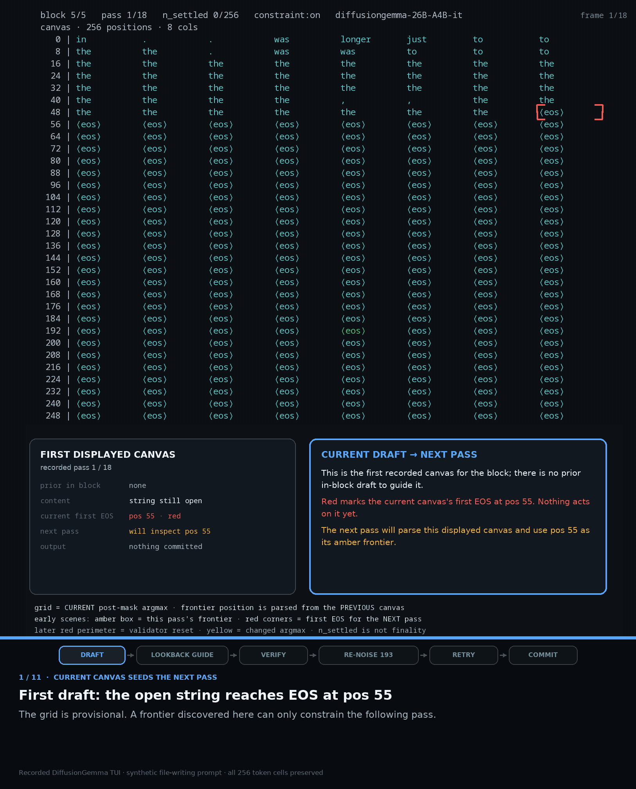
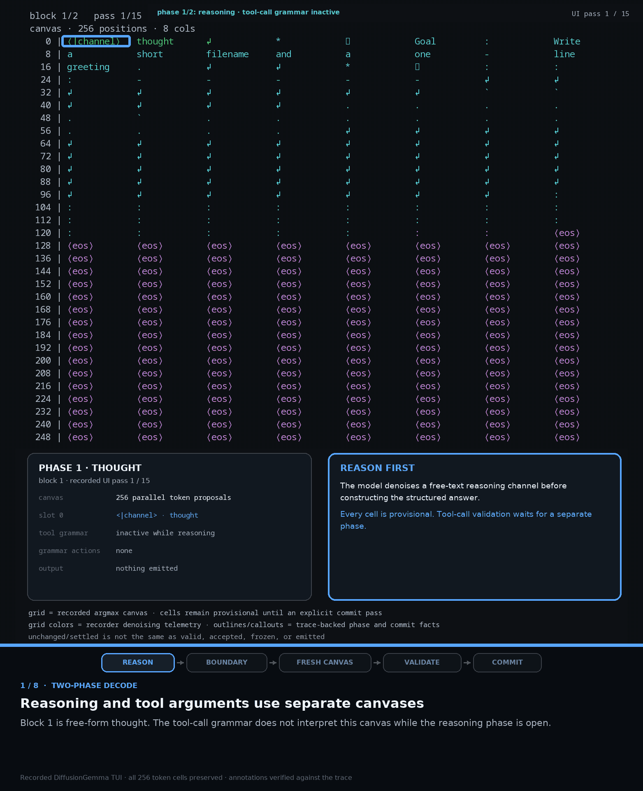

# Constrained decoding for DiffusionGemma

This branch is a research prototype that adapts grammar-constrained decoding to
a model that generates a block of tokens in parallel. It is intended to make the
idea and implementation easy to inspect; it is not an upstream-ready vLLM
change, a supported model integration, or a reproducible benchmark package.

## What is interesting here

Autoregressive constrained decoding masks one next-token distribution at a
time. DiffusionGemma instead repeatedly denoises an entire token canvas. Applying
an ordinary token-by-token grammar state machine directly to that canvas either
over-constrains the model or accepts combinations that are locally plausible but
jointly invalid.

The prototype uses an ordered-frontier strategy:

1. Let reasoning denoise without applying the tool-call grammar.
2. After the reasoning boundary, maintain an `llguidance` matcher for the
   committed answer prefix.
3. Advance a speculative matcher through the canvas's longest valid prefix and
   apply an exact grammar mask at the first invalid position.
4. Before commit, validate the realized block as a whole. Invalid tails are
   re-noised for another denoising attempt, with a bounded termination fallback.
5. Carry matcher state across canvas blocks for long calls, while splitting
   multiple calls at their Gemma4 tool-call boundary.

## Visual walkthrough

A converged candidate omits the required `filename` field. The validator blocks
the commit, re-noises only the invalid suffix, and the model regenerates the
missing argument:



Reasoning and structured output use separate canvas blocks. The reasoning block
commits only through its first channel close; a fresh grammar-aware block then
validates and commits the tool call:



The implementation is disabled by default. To inspect the experimental path:

```bash
VLLM_DIFFUSION_CONSTRAINED_DECODE=1 \
  vllm serve <diffusion-gemma-checkpoint> \
  --enable-auto-tool-choice \
  --tool-call-parser gemma4
```

The branch also includes a Gemma4-native grammar generator that supports nested
objects and arrays, local `$ref` definitions, unions, enums, optional parameters,
parallel calls, and natural-language fallback.

## Evaluation snapshot

The strongest controlled result was a same-build greedy BFCL comparison over
4,441 examples:

| Metric | Base | Constrained | Difference |
| --- | ---: | ---: | ---: |
| Overall accuracy | 73.0016% | 76.6269% | +3.6253 pp |
| Multi-turn accuracy | 52.125% | 58.500% | +6.375 pp |
| No-tool-call rate | 2.837% | 1.846% | -0.991 pp |

A separate four-sample BFCL run showed the same direction:

| Metric | Base | Constrained | Difference |
| --- | ---: | ---: | ---: |
| Overall pass@1 | 72.90% | 75.42% | +2.52 pp |
| Overall pass^4 | 59.92% | 67.57% | +7.65 pp |
| Multi-turn pass^4 | 23.50% | 35.25% | +11.75 pp |
| Malformed outputs | 2.81% | 2.00% | -0.81 pp |

Across the airline, telecom, and retail domains in a separate tau2 agentic
evaluation, the macro averages also favored constraints:

| Metric | Base | Constrained | Difference |
| --- | ---: | ---: | ---: |
| Pass@1 | 59.8% | 60.7% | +0.9 pp |
| Pass@4 | 70.7% | 72.7% | +2.0 pp |
| Pass^4 | 48.0% | 48.1% | +0.1 pp |
| Malformed outputs | 1.26% | 0.20% | -1.06 pp |

Those tau2 runs used a small number of stochastic trials per domain, so the
most defensible takeaway is improved output reliability rather than a broad
accuracy claim. The malformed-output rate was about 6.3 times lower.

For context, the published model-card HLE-with-search scores were 11.9% for
DiffusionGemma and 17.2% for autoregressive Gemma4. A local constrained run
reached 13.801% (289/2,094 valid examples; 406 additional examples were excluded
for infrastructure reasons). There was no matched local base or autoregressive
arm, so that number is contextual evidence, not a controlled improvement claim.

## Performance tradeoff

On the same-build BFCL run, constrained decoding reduced throughput from 150.11
to 107.33 tokens/s (about 28.5%) and increased mean per-call latency from 3.018
to 4.198 seconds (about 39%). Mean output length was approximately flat. The main
costs are grammar-frontier work, device-to-host synchronization for canvas
validation, and extra denoising after invalid convergence.

## Prototype caveats

- This is a curated code snapshot, not the original experiment harness.
- Raw traces, forensic backups, private paths, dashboards, and benchmark drivers
  were deliberately excluded.
- Gemma4 special-token IDs are currently encoded in the grammar defaults.
- The constraint path is tailored to Gemma4 tool-call syntax and is not a general
  structured-output solution for every diffusion model.
- Full end-to-end validation requires the matching DiffusionGemma checkpoint,
  compatible CUDA kernels, and the original evaluation environment.
- The checked-in results summarize prior runs; this branch does not include the
  datasets or infrastructure needed to reproduce them.
